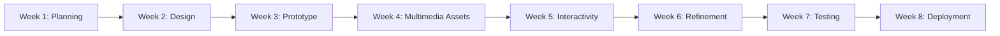
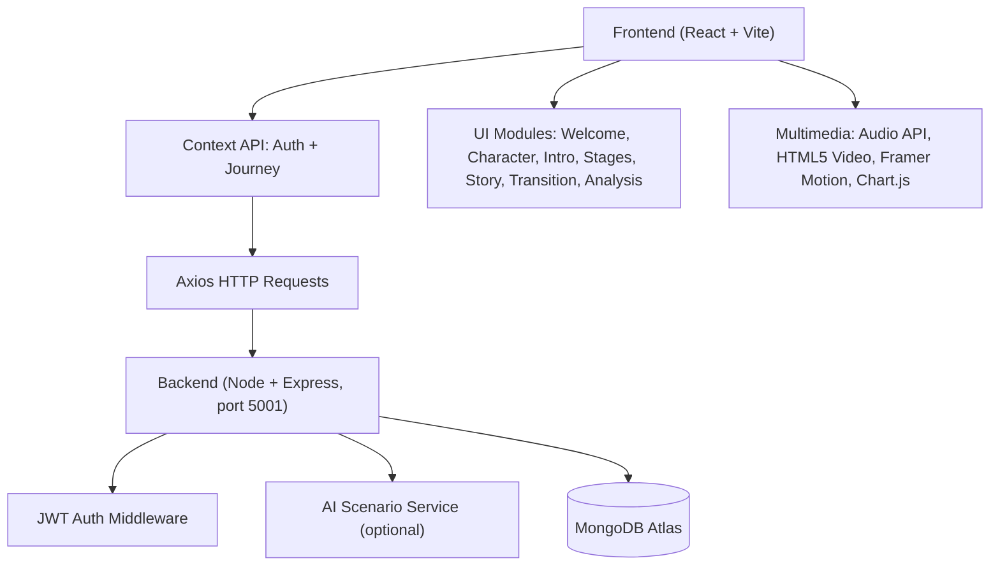
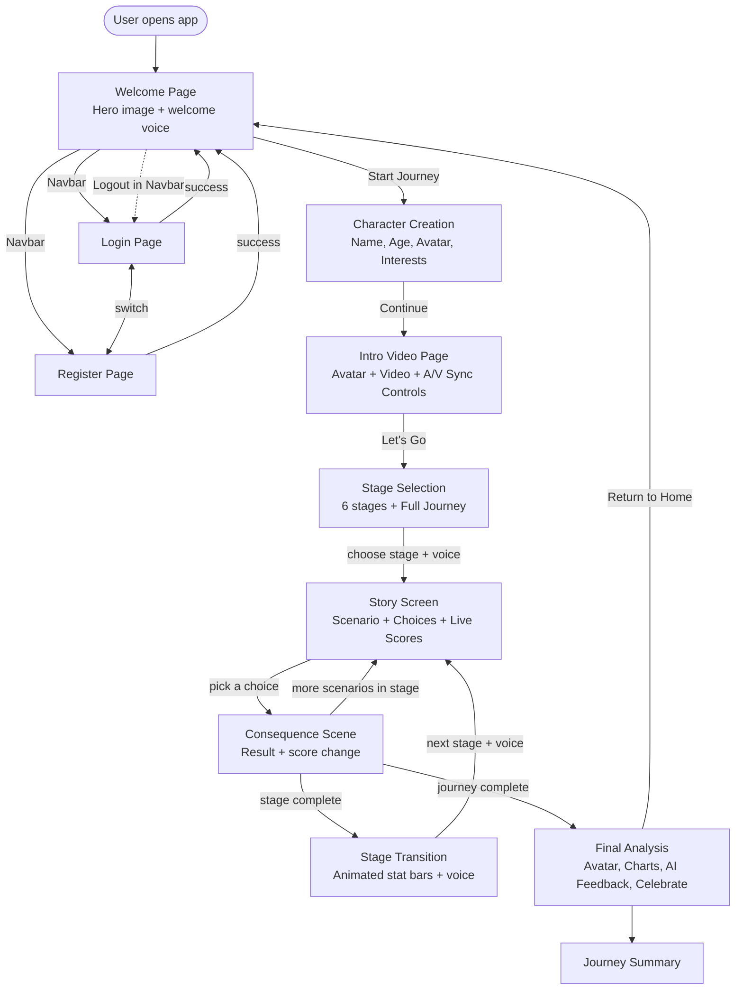
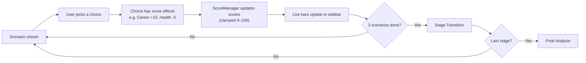

# PathWeaver — Project Plan

**Project Title:** PathWeaver – An Interactive Multimedia Life Simulation
**Project Type:** Web-based interactive multimedia application
**Tech Stack:** MERN (MongoDB, Express.js, React.js, Node.js) + Tailwind CSS + Framer Motion + Chart.js
**Project Location:** `/Users/ritesh/Downloads/PathWeaver`

---

## 1. Timeline

Total duration: **8 weeks**

| Week | Phase | Key Activities | Deliverable | Status |
|---|---|---|---|---|
| **Week 1** | Planning & Research | Finalise idea, study similar games, define life stages and scoring system, pick the tech stack | Project proposal, requirement document | ✅ Done |
| **Week 2** | Design | Wireframes, storyboard, navigation map, colour theme (light/white UI), choose fonts | UI mockups, storyboard | ✅ Done |
| **Week 3** | Prototype Development | Set up the MERN project, MongoDB Atlas, JWT authentication, core screens, story engine with fallback `story.json` | Working prototype | ✅ Done |
| **Week 4** | Multimedia Asset Development | Images & graphics, audio clips, voiceovers, intro video, animations, icons & fonts | Asset library in `client/public/assets/` | ✅ Done |
| **Week 5** | Interactivity & Integration | Interactive buttons/menus, A/V sync controls, stage transition animations, celebration effect | Fully interactive build | ✅ Done |
| **Week 6** | Feature Refinement | Avatar on intro & results pages, hide Relationships in student stages, Home/Logout flow, remove Leaderboard | Refined build | ✅ Done |
| **Week 7** | Testing & Debugging | Functional testing, cross-browser checks (Chrome/Safari), audio autoplay fixes, responsive checks | Test report, bug fixes | 🔄 In progress |
| **Week 8** | Deployment & Documentation | Deploy (Vercel + Render), write final report, record demo video, final presentation | Live URL, report, presentation | ⏳ Planned |

---

## 2. Project Modules

| # | Module | Description | Main Files |
|---|---|---|---|
| 1 | **Authentication** | Register, login, logout with JWT tokens and bcrypt-hashed passwords; redirects to Login after logout | `Auth/Login.jsx`, `Auth/Register.jsx`, `AuthContext.jsx`, server auth routes |
| 2 | **Welcome / Landing** | Hero background, floating particle animation, welcome voiceover, Start Journey button | `Welcome.jsx` |
| 3 | **Character Creation** | User enters name and age, chooses one of 5 avatars and their interests | `CharacterCreation.jsx` |
| 4 | **Intro Multimedia** | Background video, voiceover, avatar display, interactive A/V sync controls (play/pause/mute), animated equalizer | `IntroVideo.jsx` |
| 5 | **Stage Selection** | Pick any of 6 life stages or the full journey; voice announces the chosen stage | `StageSelection.jsx` |
| 6 | **Story Engine** | Loads AI-generated scenarios (with fallback to `story.json`), 3 scenarios per stage | `engine/StoryEngine.js`, `data/story.json` |
| 7 | **Decision & Consequence** | User picks a choice → scores update → consequence screen with sound effects | `StoryScreen.jsx`, `ConsequenceScene.jsx` |
| 8 | **Score Management** | Tracks Career, Health, Finance, Relationships, Happiness; Relationships hidden in Childhood/School/College | `engine/ScoreManager.js`, `JourneyContext.jsx` |
| 9 | **Stage Transition** | "Phase Complete" screen with animated count-up stat bars and voiceover | `StageTransition.jsx` |
| 10 | **Final Analysis** | Avatar + name, Radar and Bar charts, achievements, AI feedback, confetti celebration, Return to Home | `FinalAnalysis.jsx` |
| 11 | **Journey Summary / Report** | Timeline of all decisions taken | `JourneySummary.jsx`, `LifeReport.jsx` |
| 12 | **Backend API & Database** | Express REST API, MongoDB Atlas models for users and journeys | `server/server.js`, `server/models/`, `server/routes/` |

---

## 3. Roles and Skills

| Role | Responsibilities | Skills Needed |
|---|---|---|
| **Project Manager** | Planning, timeline tracking, coordinating tasks, reporting to the mentor | Planning, communication, documentation |
| **UI/UX Designer** | Wireframes, storyboard, light colour theme, layout, choosing fonts and icons | Figma/Canva, colour theory, typography, user flow design |
| **Frontend Developer** | Building React components, routing, state management, responsive UI | React.js, JavaScript (ES6+), Tailwind CSS, React Router, Context API |
| **Backend Developer** | REST API, authentication, database models, server configuration | Node.js, Express.js, JWT, bcrypt, REST API design |
| **Database Administrator** | MongoDB Atlas setup, schemas, access control, connection strings | MongoDB, Mongoose, NoSQL data modelling |
| **Multimedia Developer** | Creating and editing images, audio clips, voiceovers, intro video | Image editing, audio editing (Audacity), TTS tools, video editing |
| **Animation Developer** | Page transitions, stat-bar animations, equalizer, confetti effect | Framer Motion, CSS animations, keyframes, easing functions |
| **Content / Story Writer** | Writing the scenarios, choices, and consequences for all 6 life stages | Creative writing, storytelling, game logic |
| **QA Tester** | Testing all flows, browser compatibility, audio/video behaviour | Manual testing, bug reporting, DevTools |

> [!NOTE]
> In this project, all roles were handled by a **single developer** (Ritesh Kumar) with an AI coding assistant.

---

## 4. Resources / Assets Required

### 4.1 Multimedia Assets

| Category | Asset | Format | Location | Used In |
|---|---|---|---|---|
| **Images** | Hero / journey illustration | JPG | `assets/images/hero_bg.jpg` | Welcome, Login, Register |
| | Childhood stage art | JPG | `assets/images/stage_childhood.jpg` | Stage screens |
| | School stage art | JPG | `assets/images/stage_school.jpg` | Stage screens |
| **Audio – SFX** | Click sound | WAV | `assets/audio/click.wav` | Buttons, decisions |
| | Success sound | WAV | `assets/audio/success.wav` | Consequence, Celebrate |
| **Audio – Voice** | Welcome voiceover | M4A | `assets/audio/voice/welcome.m4a` | Welcome page |
| | Intro voiceover | M4A | `assets/audio/voice/intro_video.m4a` | Intro page |
| | Stage voiceovers (×6) | M4A | `assets/audio/voice/childhood.m4a` … `retirement.m4a` | Stage start |
| | Phase complete voiceover | M4A | `assets/audio/voice/complete.m4a` | Stage Transition |
| **Video** | Intro background video | MP4 | `assets/video/intro.mp4` | Intro page |
| **Animations** | Particles, stat bars, equalizer, confetti, page transitions | Framer Motion (code) | Components | All pages |
| **Icons** | Avatars, stage icons, UI icons | Emoji / Unicode | Components | All pages |
| **Fonts** | Outfit (headings), Inter (body) | Google Fonts | `index.html` | All pages |

### 4.2 Software & Tools

| Category | Tools |
|---|---|
| Code editor | VS Code / Antigravity IDE |
| Runtime and packages | Node.js v22, npm |
| Frontend | React 18, Vite, Tailwind CSS, Framer Motion, Chart.js, React Router, Axios |
| Backend | Express.js, Mongoose, JWT, bcrypt, dotenv, nodemon |
| Database | MongoDB Atlas (cloud) |
| Multimedia | macOS `say` TTS + `afconvert`, Python (for synthesised SFX), AI image generation |
| Version control | Git |
| Testing | Chrome DevTools, Safari |
| Design | Figma / Canva |

### 4.3 Hardware

- MacBook Air (development machine)
- Headphones (for testing audio)
- Stable internet connection (for MongoDB Atlas and AI APIs)

---

## 5. Budget

> [!TIP]
> PathWeaver was built almost entirely with **free tools and free tiers**, so the actual development cost is close to zero. The table below shows both the actual cost and an estimate for a production version.

### 5.1 Development Cost (Actual)

| Item | Provider | Plan | Cost (₹) |
|---|---|---|---|
| Database | MongoDB Atlas | M0 Free Tier (512 MB) | 0 |
| Frontend hosting | Vercel / Netlify | Free tier | 0 |
| Backend hosting | Render | Free tier | 0 |
| Code editor | VS Code | Free | 0 |
| Libraries | React, Express, Framer Motion, Chart.js | Open source | 0 |
| Fonts | Google Fonts | Free | 0 |
| Voiceovers | macOS Text-to-Speech | Built-in | 0 |
| Intro video | Open-licensed (Creative Commons) | Free | 0 |
| AI scenarios (optional) | OpenAI API | Pay-as-you-go | ~₹200–500 |
| Internet | Existing connection | — | — |
| **Total (actual)** | | | **₹0 – ₹500** |

### 5.2 Estimated Production Budget (Optional Upgrade)

| Item | Provider | Monthly Cost (₹) |
|---|---|---|
| Professional AI voices | ElevenLabs Starter | ~₹420 |
| AI scenario generation | OpenAI API | ~₹800 |
| Database | MongoDB Atlas M10 | ~₹4,800 |
| Backend hosting | Render Starter | ~₹600 |
| Custom domain | GoDaddy / Namecheap | ~₹80 (₹999/year) |
| Stock media | Envato / Shutterstock | ~₹1,400 |
| **Total (production)** | | **~₹8,100 / month** |

### 5.3 Manpower Estimate (if outsourced)

| Role | Effort | Rate (₹/hr) | Cost (₹) |
|---|---|---|---|
| UI/UX Designer | 30 hrs | 500 | 15,000 |
| Frontend Developer | 80 hrs | 600 | 48,000 |
| Backend Developer | 50 hrs | 600 | 30,000 |
| Multimedia Developer | 30 hrs | 500 | 15,000 |
| Content Writer | 20 hrs | 400 | 8,000 |
| QA Tester | 20 hrs | 400 | 8,000 |
| **Total** | **230 hrs** | | **₹1,24,000** |

---

## 6. Project Description

### 6.1 Overview

**PathWeaver** is an interactive multimedia life-simulation web application. The user creates a character and moves through six life stages: **Childhood → School → College → Career → Family → Retirement**. In each stage the user faces real-life scenarios and makes decisions. Every decision changes five life scores: **Career, Health, Finance, Relationships, and Happiness**. At the end, the user gets a visual analysis of the life they built.

**Objectives**
- Teach decision-making and how choices have consequences, through gameplay
- Show multimedia integration: images, audio, voiceovers, video, and animation
- Give an engaging, interactive, and personalised experience

**Target audience:** Students and young adults (age 13+)

### 6.2 Navigation Map

### 6.3 Storyboard

| Scene | Screen | Visuals | Audio | Interaction | Next |
|---|---|---|---|---|---|
| **1** | Welcome | Journey hero image, floating animated particles, PathWeaver title | Voice: *"Welcome to PathWeaver. Start your journey."* | Click **Start Journey**; Login/Register in navbar | Character Creation |
| **2** | Login / Register | Split screen: full journey illustration on the left, white form on the right | — | Enter email/password; switch between Login and Register | Welcome |
| **3** | Character Creation | White card with form, 5 avatar tiles, interest chips | Click sound | Type name/age, pick an avatar, toggle interests, click **Continue** | Intro |
| **4** | Intro Video | Greeting with name, chosen avatar card, looping background video, 3 feature cards | Voice: *"Your journey begins now…"* | Hover video → A/V menu (Play/Pause, Mute, animated equalizer) → **Let's Go** | Stage Selection |
| **5** | Stage Selection | 6 stage cards with icons and descriptions, "Explore Full Journey" banner | Voice: *"Entering the [Stage] phase."* | Click a stage card | Story Screen |
| **6** | Story Screen | Timeline sidebar, live score bars, stage badge, scenario text, choices A/B/C | Click sound | Pick a choice | Consequence |
| **7** | Consequence | Outcome text, score changes (+/−) | Click / success sound | Click **Continue** | Story or Transition |
| **8** | Stage Transition | 🌟 spinning star, "Phase Complete!", stat bars filling 0 → score with counting numbers (Relationships hidden in student stages) | Voice: *"Phase complete. Here are your results."* + next-stage voice | Click **Start [Next] Phase** | Story Screen |
| **9** | Final Analysis | Avatar circle, "[Name]'s Life Analysis", overall score, Radar + Bar charts, achievements, AI feedback | Success sound on Celebrate | **🎉 Celebrate Results** (confetti burst), **View Summary**, **🏠 Return to Home** | Summary / Welcome |
| **10** | Logout | — | — | Click **Logout** in navbar | Login |

### 6.4 Scoring Logic

### 6.5 Multimedia Features Summary

| Requirement | How PathWeaver shows it |
|---|---|
| Images & graphics | Hero illustration, stage art, split-screen auth pages |
| Audio clips | Click/success SFX, 9 voiceover clips |
| Video | Looping intro background video |
| Animations | Particles, page transitions, count-up stat bars, equalizer, confetti |
| Icons & fonts | Emoji avatars and stage icons, Outfit + Inter fonts |
| Interactive menus/buttons | Hover/tap physics on every button, floating A/V control menu |
| A/V synchronisation | Play/Pause/Mute controls video and voice together |
| User interaction | Character creation, choices that change scores, celebrate button |
